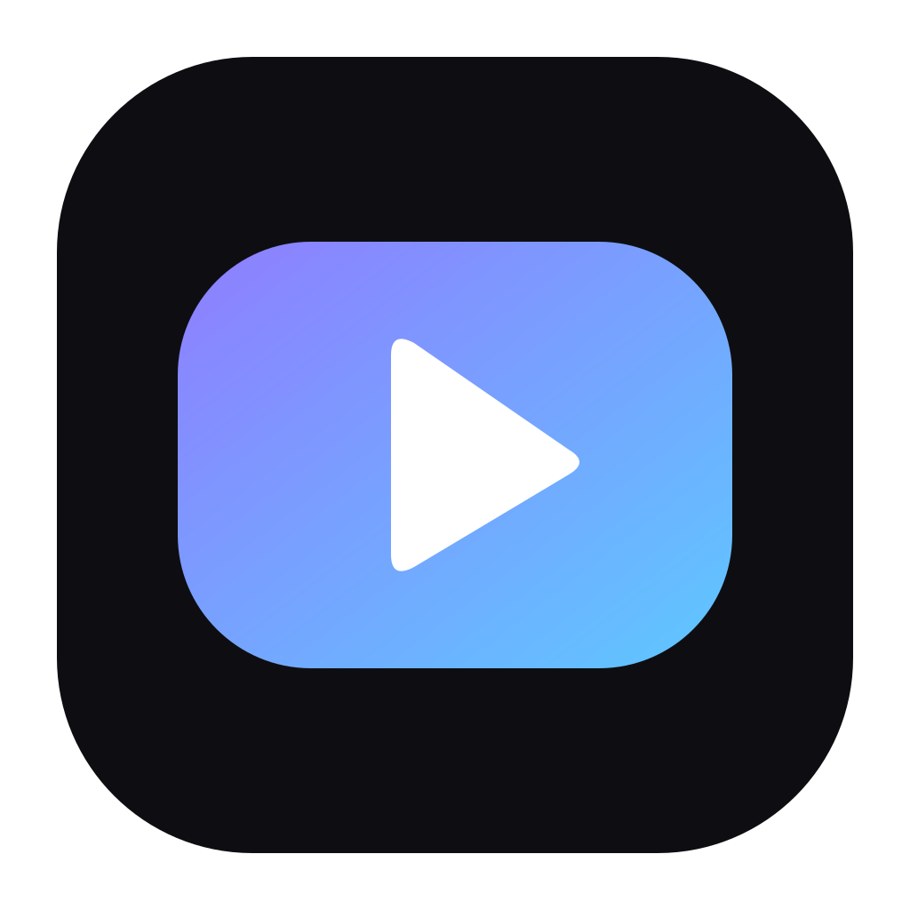

<p align="center">
  
</p>

<h1 align="center">Vista</h1>

<p align="center">
  A light, ad-free YouTube app for Android.<br />
  No account, no tracking: your subscriptions and history stay on your phone.
</p>

<p align="center">
  <a href="https://github.com/octavianbanarizatic-hub/Vista-app/releases/latest"><b>Download for Android</b></a>
  ·
  <a href="#features">Features</a>
  ·
  <a href="#how-it-works">How it works</a>
</p>

---

## Features

**Watching**
- Videos play in Android's own player, with fullscreen, picture-in-picture and background play (sound only, with the screen off).
- SponsorBlock skips sponsors, intros and the like, as you choose.
- Dislike counts from Return YouTube Dislike.
- Chapters, comments, a queue with autoplay, speed and quality, and a sleep timer.
- Videos start in a few seconds, and sooner when Vista got them ready ahead.

**Finding videos**
- Home recommends videos from what you watch, search and subscribe to, made on your phone. Topic chips (Gaming, News, Music…) narrow it down.
- "Not interested" keeps a video or a whole channel out of your recommendations.
- Search with YouTube's suggestions and your recent searches; paste or share a YouTube link to open it.

**Your stuff**
- Subscriptions without an account, or imported from Google Takeout, with notifications for new videos.
- Watch later, playlists, history with where you stopped, and downloads for watching offline.
- A backup every week in Downloads → Vista backups, and restore any time.
- Updates itself from this repository's releases.

## Install

Download the APK from the [latest release](https://github.com/octavianbanarizatic-hub/Vista-app/releases/latest) and open it on your phone (Android 7 or newer; Android asks to allow installing from your browser or file manager the first time). After that, Vista finds new versions by itself: Settings → App → Check for updates.

## How it works

Vista is built with [Tauri 2](https://tauri.app): a Rust core and a plain TypeScript page, plus a small Kotlin plugin for Android. Streams always come from [yt-dlp](https://github.com/yt-dlp/yt-dlp), which runs inside the app through [youtubedl-android](https://github.com/yausername/youtubedl-android) (with its own Python and QuickJS). Search, video and channel pages come from YouTube's web API, and the subscriptions feed from YouTube's public RSS feeds. The details are in the source: `src-tauri/src` (Rust), `src` (the page) and `src-tauri/android-plugin` (Kotlin).

### Building

Requirements: Rust, Node.js 18+, the [Tauri prerequisites](https://tauri.app/start/prerequisites/) and the Android SDK and NDK.

```bash
npm install
node scripts/android.mjs build --apk --debug --target aarch64
```

The desktop build (`npx tauri dev`) is only for testing.

## License

GPL-3.0 (youtubedl-android is GPL-3.0). See [LICENSE](LICENSE). The Inter font is under the SIL Open Font License (`src/fonts/OFL.txt`).

Streaming YouTube without its official player goes against YouTube's Terms of Service. This project is for personal and educational use.
